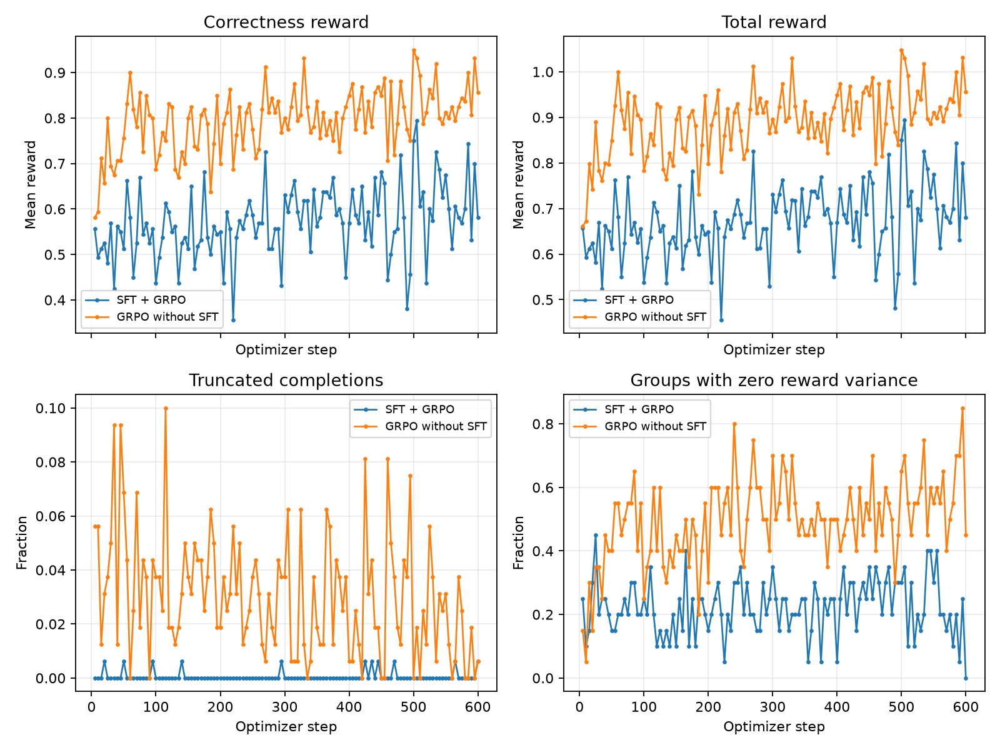
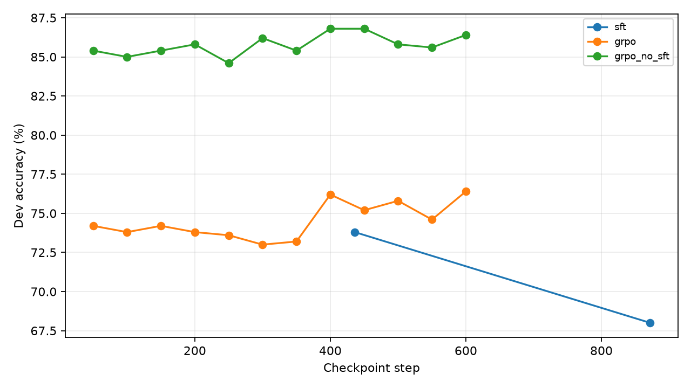
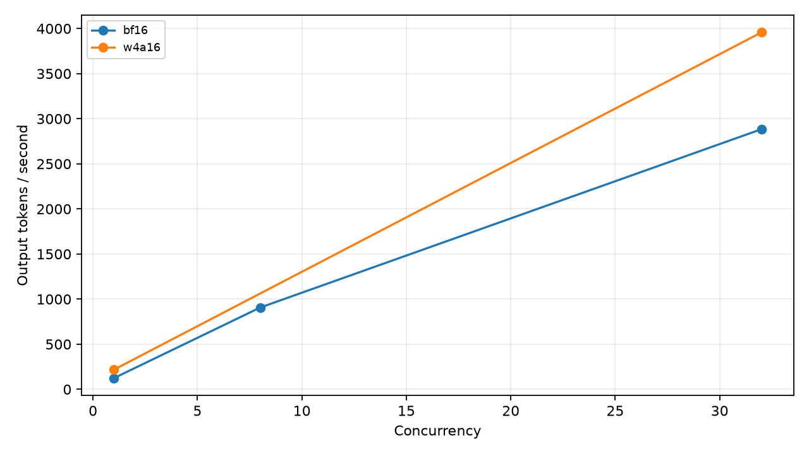

# Math Reasoning Post-Training and Efficient Serving on One 12 GB GPU

On one RTX 5070 (12 GB), SFT → GRPO reached 63.91% GSM8K accuracy versus the base
model's 68.99%; the matched GRPO without SFT reached 74.37%. vLLM achieved 11.18×
the strongest measured HF throughput, while W4A16 reduced weight-file size 2.70×
at an 8.95 pp GSM8K accuracy cost. Every table below comes from saved evidence.

<!-- BEGIN GENERATED RESULTS -->

GSM8K: base 68.99% → SFT + GRPO 63.91%; MATH-500: 55.20% → 36.00%. vLLM / strongest fitting HF throughput: 11.18×.

| Model | GSM8K accuracy (95% CI) | MATH-500 accuracy (95% CI) | Boxed GSM / MATH | Mean tokens GSM / MATH | Truncated GSM / MATH |
|---|---|---|---|---|---|
| base | 68.99% [66.49, 71.49] | 55.20% [50.80, 59.60] | 91.36% / 95.20% | 303.61 / 598.23 | 0.53% / 4.20% |
| sft | 59.67% [57.01, 62.24] | 34.20% [30.00, 38.40] | 99.55% / 91.20% | 102.19 / 339.33 | 0.38% / 8.40% |
| grpo | 63.91% [61.26, 66.41] | 36.00% [31.80, 40.20] | 99.62% / 91.80% | 102.51 / 334.82 | 0.30% / 8.00% |
| ablation | 74.37% [71.95, 76.72] | 57.20% [52.80, 61.40] | 99.62% / 96.00% | 300.32 / 575.87 | 0.38% / 4.00% |
| quantized | 54.97% [52.24, 57.62] | 22.20% [18.60, 25.80] | 99.17% / 84.40% | 108.52 / 439.70 | 0.83% / 15.00% |

Bootstrap: 10,000 resamples, seed 0. Each complete task uses 1,319 GSM8K or 500 MATH-500 questions.

| Comparison (b - a) | Task | n | Difference (pp) | Exact McNemar p | n01 / n10 |
|---|---|---:|---:|---:|---:|
| sft - base | gsm8k | 1319 | -9.33 | 1.94516e-09 | 148 / 271 |
| grpo - sft | gsm8k | 1319 | 4.25 | 2.49154e-06 | 98 / 42 |
| grpo - base | gsm8k | 1319 | -5.08 | 0.000848553 | 163 / 230 |
| grpo - ablation | gsm8k | 1319 | -10.46 | 2.26229e-13 | 110 / 248 |
| grpo - quantized | gsm8k | 1319 | 8.95 | 5.70345e-11 | 222 / 104 |
| sft - base | math500 | 500 | -21.00 | 1.12239e-16 | 32 / 137 |
| grpo - sft | math500 | 500 | 1.80 | 0.232693 | 27 / 18 |
| grpo - base | math500 | 500 | -19.20 | 3.39096e-15 | 30 / 126 |
| grpo - ablation | math500 | 500 | -21.20 | 1.53189e-18 | 25 / 131 |
| grpo - quantized | math500 | 500 | 13.80 | 2.91236e-10 | 96 / 27 |

| Engine | Precision | Batch / concurrency | Output tok/s | TTFT p50 / p99 (ms) | TPOT p50 / p99 (ms) |
|---|---|---:|---:|---:|---:|
| HF offline | bf16 | batch 1 | 31.42 | — | — |
| HF offline | bf16 | batch 8 | 229.41 | — | — |
| HF offline | bf16 | batch 16 | 470.07 | — | — |
| HF offline | bf16 | batch 32 | 912.04 | — | — |
| vLLM offline | bf16 | continuous batching | 10196.52 | — | — |
| vLLM online | bf16 | 1 | 123.76 | 24.69 / 37.97 | 7.88 / 10.19 |
| vLLM online | bf16 | 8 | 906.20 | 99.18 / 135.40 | 8.42 / 9.04 |
| vLLM online | bf16 | 32 | 2883.76 | 231.44 / 448.82 | 10.01 / 11.17 |
| vLLM online | w4a16 | 1 | 217.18 | 23.99 / 31.94 | 4.47 / 5.20 |
| vLLM online | w4a16 | 32 | 3956.96 | 231.43 / 491.41 | 7.11 / 8.12 |

Offline: identical 512 training prompts, exactly 256 output tokens, one warmup and median of three runs. Online: official vLLM CLI, 500 synthetic requests, exactly 256 input / output tokens.

E = 11.18×; G = 2.70× (checkpoint weight files only); F = 8.95 pp; quantization McNemar p = 5.70345e-11.

G measures serialized weight-file size. vLLM weight memory below is read separately from startup logs.

| Precision | Checkpoint weight bytes | vLLM loaded-weight GiB |
|---|---:|---:|
| bf16 | 3087467144 | 2.980 |
| w4a16 | 1142692360 | 1.120 |

| Resume value | A (%) | B (%) | C (%) | D (%) | E (×) | F (pp) | G (×) |
|---|---:|---:|---:|---:|---:|---:|---:|
| Measured | 68.99 | 63.91 | 55.20 | 36.00 | 11.18 | 8.95 | 2.70 |







Generated by `python -m src.report` from measured result files. Missing data stays `null` in `results/summary.json`.

<!-- END GENERATED RESULTS -->

See [results interpretation and truthful resume wording](docs/results_interpretation.md)
for the negative main result, format/length observations, and quantization tradeoffs.

## Format breakdown: where the GSM8K gain occurs

The **GRPO without SFT ablation versus base** improves GSM8K from 910/1,319
(68.99%) to 981/1,319 (74.37%): a net gain of 71 answers, or **5.38 pp**.
The paired format breakdown below uses the same saved answers and frozen judge.
`Boxed` means that the saved evaluator found a `\boxed{}` answer; without one,
the frozen evaluator scores the answer as incorrect.

| Base boxed | No-SFT GRPO boxed | Paired problems | Wrong → correct | Correct → wrong | Net correct answers | Contribution to total accuracy (pp) |
|---|---|---:|---:|---:|---:|---:|
| No | No | 2 | 0 | 0 | 0 | 0.00 |
| No | Yes | 112 | 81 | 0 | +81 | +6.14 |
| Yes | No | 3 | 0 | 0 | 0 | 0.00 |
| Yes | Yes | 1,202 | 81 | 91 | −10 | −0.76 |
| All pairs | All pairs | 1,319 | 162 | 91 | +71 | +5.38 |

The last column uses **all 1,319 test questions** as its denominator, so the
contributions sum to the overall change. On the common 1,202 questions where
both outputs are boxed, accuracy is 910/1,202 (75.71%) for base and 900/1,202
(74.88%) for the ablation. The positive net change is therefore concentrated
in questions whose outputs acquire a boxed answer; the common boxed subset
does not improve. The overall boxed rate rises from 91.36% to 99.62%, while
mean output length is similar (303.61 versus 300.32 tokens).

**This is a post-hoc descriptive split, not a causal estimate of reasoning
improvement or a new model-selection rule.** We do not re-extract or rejudge
the original unboxed answers, so this cannot establish whether adding a box
alone would have made those answers correct. Training also changes the answer
content. A defensible resume claim is: “Analyzed a 5.38 pp GSM8K gain from
no-SFT GRPO and found it concentrated in outputs gaining the required boxed
format; accuracy on the common boxed subset did not improve.”

This conclusion is specific to **base → no-SFT GRPO**. For **SFT → main GRPO**,
97 of 98 wrong → correct transitions and 41 of 42 correct → wrong transitions
already have boxed answers on both sides. Those pairs account for the net
56-answer gain (+4.25 pp); format-changing pairs contribute zero net gain.
That improvement cannot be explained by missing boxes alone, and it still
does not establish a causal improvement in reasoning. The main model remains
below base on both final tasks.

Evidence: [`results/format_analysis.json`](results/format_analysis.json)
(`posthoc_descriptive_comparisons` contains the base/ablation split;
`comparisons` retains the ten prespecified comparisons),
[`results/per_problem.csv`](results/per_problem.csv), and the
[interpretation notes](docs/results_interpretation.md#格式长度与正确率).
Reproduce the split with `python -m scripts.analyze_saved_results`; it reads
saved results and training logs, generates no new answers, and adds no
post-hoc significance test. The frozen result tables above are unchanged.

## Training and dev selection

The actual RTX5070 passed the 20-step R12 smoke test with plan B: Qwen2.5-1.5B,
Transformers continuous batching, median 64.913 seconds/step and 11.299 GiB device peak.
The synthetic W4A16 GPU kernel check also passed. SFT completed both epochs: checkpoint-436
was selected with 369/500 correct on dev (73.8%), versus 340/500 (68.0%) for checkpoint-872.
Both GRPO runs completed 600 optimizer steps. Main GRPO selected checkpoint-600 with
382/500 correct on dev (76.4%); the matched no-SFT ablation selected checkpoint-400 with
434/500 (86.8%), using the earliest-step tie rule. These are dev selection scores.
All ten final model/task evaluations and the deployment measurements are complete;
see `python -m src.progress` for current status and
[`docs/execution.md`](docs/execution.md) for the execution record.

## Reproduce

Run from this repository inside WSL2 Ubuntu, on the RTX 5070. Keep the environment separate from
other projects. The full installed dependency set is pinned in `requirements-lock.txt`.
WSL needs `build-essential`, `python3-dev`, and `pkg-config` for Triton's compiled kernels.
Install these Ubuntu packages before creating the Python environment.

```bash
uv venv ~/.venvs/llm-reasoning-grpo --python python3.12
source ~/.venvs/llm-reasoning-grpo/bin/activate
uv pip sync requirements-lock.txt
source scripts/runtime_env.sh
python -m scripts.check_cuda_runtime
python -m src.environment
python -m src.prepare
pytest -q
python -m src.protocol verify
uv venv ~/.venvs/llm-reasoning-grpo-quant --python python3.12
uv pip sync --python ~/.venvs/llm-reasoning-grpo-quant/bin/python requirements-quant-lock.txt
```

The committed `docs/frozen_manifest.json` verifies the original evaluation code, reward/parser tests,
dataset revisions and exact train/dev split. Do not create a new manifest after seeing results.
The first execution must run `python -m src.protocol freeze` and commit that protocol before smoke tests.

```bash
python -m src.smoke --config configs/smoke.yaml --record-decision
# Commit successful R12 decision before training or evaluating any model.
python -m src.train_sft --config configs/sft.yaml
python -m src.select_checkpoint --config configs/sft.yaml --stage sft
# Merge only the adapter selected on dev; see python -m src.merge --help.
python -m src.train_grpo --config configs/grpo.yaml
python -m src.select_checkpoint --config configs/grpo.yaml --stage grpo
python -m src.train_grpo --config configs/grpo_no_sft.yaml
python -m src.select_checkpoint --config configs/grpo_no_sft.yaml --stage ablation
```

Use `python -m src.pipeline` for the guarded sequential end-to-end execution; it saves each stage's
status and log. Quantization uses its own environment if package requirements conflict.
The initial compatibility stage builds a synthetic checkpoint in the quantization environment,
checks it in the serving environment, then runs its GPU kernel; it does not rely on cached `/tmp` files.
All test evaluation is deferred until the selected bf16 models and quantized artifact are ready.
Generation, training and serving never share the GPU concurrently.
`python -m src.progress` reads current steps and stage status without accessing a model or dataset.
The Windows launcher is `scripts/run_project.ps1`; it prevents system sleep only while the pipeline runs.
On Windows, `pwsh -NoProfile -File scripts/watch_project.ps1` displays read-only live status;
see [`docs/monitoring.md`](docs/monitoring.md) for logs and optional GPU monitoring.

To reproduce the published tables from saved raw evidence, use `python -m src.report --update-readme`;
this does not generate answers or reread test datasets. A cloned completed run keeps its ledgers
and stage records; the pipeline will refuse to replace missing or changed recorded artifacts.
After final measurements, `python -m scripts.check_saved_report_cpu --require-minimal-env`
checks every saved answer and reconstructs the exact JSON/Markdown tables in the CPU workflow
environment, without model packages, generation, or modifying the saved report.
For a fresh GPU replication, create an independent experiment from the committed source:

```bash
python scripts/new_experiment.py ../llm-reasoning-grpo-reproduction
cd ../llm-reasoning-grpo-reproduction
python -m src.environment
python -m src.prepare
python -m src.pipeline
```

This copies the unchanged evaluation code, dependency locks and split, records the source commit,
and excludes old scores, selections and ledgers. It creates no remote and leaves this experiment intact.

## Files and evidence

- `configs/`: versioned hyperparameters, immutable Hub revisions and R12 decision.
- `splits/gsm8k_split.json`: all original train IDs, partitioned 6,973/500 with seed42.
- `docs/protocol.md`: evaluation, selection, memory and benchmark protocol.
- `results/per_problem.csv`: 9,095 final per-problem records, with immutable raw-output provenance.
- `results/summary.json`, `RESULTS.md`: generated tables, paired statistics and resume values.
- `results/serve/`, `results/offline_*.json`, `results/quantization.json`: raw measurement evidence.
- `logs/`: training metrics, smoke attempts and run manifests.
- `.github/workflows/cpu-tests.yml`: CPU parser/reward/statistics tests.

Checkpoints, merged models and quantized weights are excluded from Git. The public repository is
[`hennyi-yin/llm-reasoning-grpo`](https://github.com/hennyi-yin/llm-reasoning-grpo).
The automated local commits are attributed to `Codex <codex@local>`.
After all measurements, `python -m scripts.package_release` packages the three selected adapters,
three merged BF16 models and W4A16 checkpoint with a SHA256 manifest under ignored `release_assets/`.
It verifies the final report, ledgers and source artifacts first. Existing complete archives are
verified on rerun; partial archives are preserved for inspection. The Windows launcher includes
this final packaging step. `results/release_package.json` records local archive hashes;
the packager itself does not upload files.
Each archive includes the selected base model's upstream license; the manifest records its
model revision and license hash. Source license files and provenance are in `licenses/`.
See [`docs/release_artifacts.md`](docs/release_artifacts.md) for extraction paths and loading
the adapters against their correct base model, or serving the merged BF16/W4A16 artifacts.
GitHub [limits each Release upload to less than 2 GiB](https://docs.github.com/en/repositories/releasing-projects-on-github/about-releases).
Archives larger than 1 GiB also produce ordered `.part001`, `.part002`, etc. Upload the files
listed under each artifact's `upload_files` in the manifest, together with `manifest.json`.
Join all parts in their listed order to reconstruct the archive and verify its SHA256 before
extraction. The packager checks every part and the reconstructed archive on reuse.

Model downloads are published under [Release v1.0.0](https://github.com/hennyi-yin/llm-reasoning-grpo/releases/tag/v1.0.0).
`results/publication.json` records the uploaded files and their GitHub SHA256 digests after publication.
`release_assets/manifest.json` keeps the original local packaging record (`uploaded: false`);
publication status is recorded separately so its verified hashes remain stable.

## Environment compatibility

The requested `vllm==0.31.0` and `trl==1.14.2` are installed without TRL's optional vLLM extra.
That extra requires vLLM<=0.30.0; smoke tests validate the specified pair rather than silently changing
it. vLLM0.31.0 installs torch2.13.0 with CUDA13.0 runtime, so the actual runtime differs from the
source document's CUDA12.8 environment. The detected driver supports CUDA13.4.
See [`results/environment.json`](results/environment.json) and the full lockfile for measured details.

## Limitations

GSM8K may have appeared in Qwen2.5 pretraining data; these experiments measure relative changes
in a common base model rather than uncontaminated general intelligence. MATH-500 checks transfer
within mathematics, not generalization across domains. This is one GPU and greedy pass@1 only.
Box-format improvement need not imply better reasoning; correctness, box rate, output length and
truncation are reported separately. Weight-file size ratio is not total serving VRAM reduction.
Keep zero/negative changes and nonsignificant McNemar results in the final report.

## References

[Qwen2.5 model](https://huggingface.co/Qwen/Qwen2.5-1.5B-Instruct),
[GSM8K](https://huggingface.co/datasets/openai/gsm8k),
[MATH-500](https://huggingface.co/datasets/HuggingFaceH4/MATH-500),
[TRL1.14.2 metadata](https://pypi.org/pypi/trl/1.14.2/json),
[vLLM0.31.0 metadata](https://pypi.org/pypi/vllm/0.31.0/json),
[GRPO trainer](https://huggingface.co/docs/trl/grpo_trainer),
[vLLM service benchmark](https://docs.vllm.ai/en/latest/cli/bench/serve/),
[llm-compressor](https://github.com/vllm-project/llm-compressor).
